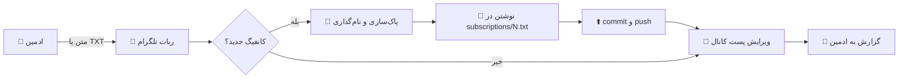

<div align="center">

# 🏴‍☠️ NetiShield Manager

**مدیریت خودکار ساب‌لینک‌های V2Ray از طریق تلگرام، با GitHub Actions**

[


](https://github.com/OWNER/REPO/actions/workflows/run-manager.yml)


کانفیگ‌ها را در تلگرام می‌فرستید، ربات آن‌ها را پاک‌سازی و دسته‌بندی می‌کند، در ۷ فایل ساب‌لینک منتشر می‌کند و پست کانال را به‌روز نگه می‌دارد.

</div>

---

## ✨ ویژگی‌ها

| | قابلیت | توضیح |
|:---:|---|---|
| 📥 | **ورودی انعطاف‌پذیر** | متن، چند خطی، ساب‌لینک base64 یا فایل `.txt` |
| 🧹 | **پاک‌سازی هوشمند** | حذف تکراری‌ها، لینک‌های وب، VMess و خطوط کامنت |
| 🏷 | **نام‌گذاری یکنواخت** | هر کانفیگ نام ثابت و شماره‌دار می‌گیرد |
| 🔄 | **چرخش ۷ فایل** | هر بار قدیمی‌ترین ساب جایگزین می‌شود |
| 📊 | **دسته‌بندی پروتکل‌ها** | VLESS، Trojan، Shadowsocks، SOCKS، Hysteria2، TUIC |
| 📣 | **پست کانال زنده** | یک پیام واحد که در هر اجرا ویرایش می‌شود |
| 🧾 | **گزارش کامل ادمین** | تعداد نهایی، حذف‌شده‌ها، لینک و وضعیت کانال |
| ⏱ | **اجرای خودکار** | زمان‌بندی هر ۱۵ دقیقه با GitHub Actions |
| 🆕 | **Rich Message** | جدول، بخش‌های باز و بسته، و نسخه‌ی ساده‌ی خودکار در صورت نیاز |

---

## 🧭 نحوه‌ی کار



هر اجرا چند ثانیه طول می‌کشد، پیام‌های صف را می‌خواند و خاموش می‌شود. سرور دائمی لازم نیست.

---

## 🗂 ساختار پروژه

```
.
├── .github/workflows/run-manager.yml   ⏱ زمان‌بندی و مراحل اجرا
├── src/
│   ├── index.js        🧠 هماهنگ‌کننده‌ی اصلی
│   ├── collect.js      📥 خواندن پیام‌ها و فایل‌ها
│   ├── processor.js    🧹 پاک‌سازی، تکراری‌ها، نام‌گذاری
│   ├── github.js       🔄 چرخش ۷ فایل ساب
│   ├── channel.js      📣 پست کانال و دکمه‌ها
│   ├── report.js       🧾 گزارش ادمین
│   ├── telegram.js     🔌 کلاینت Bot API
│   └── state.js        💾 خواندن و نوشتن امن state
├── subscriptions/      📦 ساب‌لینک‌ها (1.txt تا 7.txt)
├── state/              🗃 offset، چرخش، شناسه‌ی پست کانال
├── test/               ✅ تست‌های واحد
└── package.json
```

---

## 🚀 راه‌اندازی

راه‌اندازی در **۶ مرحله** انجام می‌شود. هر مرحله را کامل انجام دهید و به مرحله‌ی بعد بروید.

<details open>
<summary><b>۱️⃣ ساخت ربات تلگرام</b></summary>

1. در تلگرام به [@BotFather](https://t.me/BotFather) پیام دهید.
2. دستور `/newbot` را بفرستید.
3. نام و نام کاربری ربات را انتخاب کنید.
4. **توکن** را کپی کنید. این توکن را در جای امن نگه دارید و هرگز در کد یا ریپازیتوری عمومی قرار ندهید.

> 💡 اگر توکن لو رفت، با `/revoke` در BotFather توکن جدید بگیرید.

</details>

<details open>
<summary><b>۲️⃣ پیدا کردن آیدی ادمین</b></summary>

1. به [@userinfobot](https://t.me/userinfobot) پیام دهید.
2. عدد **Id** خودتان را کپی کنید.

ربات فقط به پیام‌های همین کاربر پاسخ می‌دهد.

</details>

<details open>
<summary><b>۳️⃣ ساخت کانال و افزودن ربات</b></summary>

1. یک کانال بسازید (عمومی یا خصوصی).
2. ربات را به‌عنوان **ادمین** کانال اضافه کنید.
3. این دو حق را فعال کنید:
   - ✅ **Post messages**
   - ✅ **Edit messages**
4. آیدی کانال را پیدا کنید:
   - **عمومی:** `@نام_کانال`
   - **خصوصی:** یک پیام از کانال را به @userinfobot فوروارد کنید. عدد به شکل `-100...` است.

</details>

<details open>
<summary><b>۴️⃣ تنظیم Secrets در GitHub</b></summary>

مسیر: **Settings → Secrets and variables → Actions → New repository secret**

| نام Secret | مقدار | ضروری |
|---|---|:---:|
| `TELEGRAM_BOT_TOKEN` | توکن ربات از BotFather | ✅ |
| `TELEGRAM_ADMIN_ID` | آیدی عددی ادمین | ✅ |
| `TELEGRAM_CHANNEL_ID` | `@کانال` یا `-100...` | ⭕ (برای پست کانال) |

> `GITHUB_TOKEN` خودکار ساخته می‌شود و نیازی به تنظیم ندارد.

</details>

<details open>
<summary><b>۵️⃣ دسترسی نوشتن برای Workflow</b></summary>

مسیر: **Settings → Actions → General → Workflow permissions**

گزینه‌ی **Read and write permissions** را انتخاب کنید و ذخیره کنید.

> ⚠️ بدون این گزینه، ربات نمی‌تواند تغییرات را push کند.

</details>

<details open>
<summary><b>۶️⃣ اجرای اول</b></summary>

1. تب **Actions** را باز کنید.
2. Workflow با نام **NetiShield Manager** را انتخاب کنید.
3. روی **Run workflow** بزنید.
4. اگر قبلاً پیامی به ربات فرستاده‌اید، پردازش می‌شود. در غیر این صورت گزارش «هیچ کانفیگی یافت نشد» می‌آید.

🎉 اگر گزارش به تلگرام رسید، راه‌اندازی کامل است.

</details>

---

## 📖 راهنمای استفاده (برای ادمین)

<details>
<summary><b>📤 ارسال کانفیگ‌ها</b></summary>

- **متن:** چند خط کانفیگ را در یک پیام بفرستید. کامنت با `#` یا `//` در ابتدای خط نادیده گرفته می‌شود.
- **فایل:** یک فایل `.txt` بفرستید (حداکثر ۵ مگابایت). فایل‌های دیگر نادیده گرفته می‌شوند.
- **ساب‌لینک base64:** مستقیم بفرستید؛ ربات آن را باز می‌کند.

</details>

<details>
<summary><b>💬 دستورات ربات</b></summary>

| دستور | کار |
|---|---|
| `/start` | نمایش راهنمای کوتاه |
| `/help` | نمایش راهنمای کوتاه |

</details>

<details>
<summary><b>🧾 خواندن گزارش</b></summary>

بعد از هر اجرا، گزارش شامل این موارد است:

- **تعداد نهایی:** کانفیگ‌های منتشرشده
- **VMess حذف‌شده، تکراری‌ها، نامعتبرها:** شمارش موارد پاک‌شده
- **دسته‌بندی پروتکل‌ها:** تعداد هر پروتکل
- **فایل آپدیت‌شده و لینک ساب:** فایلی که در این اجرا عوض شد
- **وضعیت پست کانال:** جدید، ویرایش‌شده یا خطا

</details>

<details>
<summary><b>⏱ زمان‌بندی</b></summary>

در `run-manager.yml`:

```yaml
schedule:
  - cron: "*/15 * * * *"   # هر ۱۵ دقیقه (UTC)
```

- GitHub ممکن است اجرا را چند دقیقه دیرتر انجام دهد.
- اگر ریپازیتوری ۶۰ روز بدون فعالیت بماند، زمان‌بندی غیرفعال می‌شود. از تب Actions دوباره فعالش کنید.
- اجرای دستی همیشه با **Run workflow** ممکن است.

</details>

---

## 🎨 سفارشی‌سازی برای برند شما

<details>
<summary><b>🏷 تغییر نام و متن‌ها</b></summary>

| فایل | بخش | تغییر |
|---|---|---|
| `src/channel.js` | `buildRichPost`، `buildChannelPost` | عنوان، توضیح، متن راهنما، هشتگ‌ها |
| `src/report.js` | `HELP_TEXT`، `NO_INPUT_TEXT` | پیام‌های ربات |
| `src/index.js` | `postToChannel` | برچسب‌های وضعیت کانال |
| `src/processor.js` | `REMARK_PREFIX` | پیشوند نام کانفیگ‌ها (پیش‌فرض `@netishield-`) |

</details>

<details>
<summary><b>🛒 تغییر لینک خرید</b></summary>

در `src/channel.js`:

```js
export const SHOP_URL = "https://t.me/your_shop_bot";
```

برچسب دکمه در تابع `buildKeyboard` است.

</details>

<details>
<summary><b>📦 تغییر تعداد ساب‌لینک‌ها</b></summary>

این سه مورد باید همزمان تغییر کنند:

1. `SLOT_COUNT` در `src/channel.js`
2. `SLOT_COUNT` در `src/github.js`
3. فایل‌های `subscriptions/1.txt` تا `subscriptions/N.txt`

و آرایه‌ی `KEYCAPS` در `src/channel.js` را هم به تعداد جدید برسانید.

</details>

<details>
<summary><b>🔌 انتخاب پروتکل‌ها</b></summary>

در `src/processor.js` مجموعه‌ی `SUPPORTED` را ویرایش کنید. فقط پروتکل‌هایی را نگه دارید که کلاینت‌های شما پشتیبانی می‌کنند.

</details>

<details>
<summary><b>🎨 رنگ دکمه‌ها</b></summary>

در `buildKeyboard` مقدار `style` را تغییر دهید:

| مقدار | رنگ |
|---|---|
| `primary` | 🔵 آبی |
| `success` | 🟢 سبز |
| `danger` | 🔴 قرمز |

</details>

<details>
<summary><b>🧪 بعد از هر تغییر</b></summary>

```bash
npm run check    # بررسی نحو
npm test         # اجرای تست‌ها
```

اگر هر دو موفق بودند، تغییرات را push کنید.

</details>

---

## 🧰 عیب‌یابی

| نشانه | علت احتمالی | راه‌حل |
|---|---|---|
| 🔕 هیچ پیامی از ربات نمی‌آید | توکن یا آیدی ادمین اشتباه است | Secrets را بررسی کنید |
| 📣 پست کانال نمی‌آید | ربات ادمین نیست یا حق ندارد | حق Post و Edit را بدهید |
| ❌ `Channel post failed: ...` | خطای تلگرام | متن داخل پرانتز علت است |
| ❌ `telegram.sendPost is not a function` | `telegram.js` قدیمی است | نسخه‌ی جدید را جایگزین کنید |
| 🔒 خطای `refusing to allow` یا `Permission denied` | دسترسی Workflow فقط خواندنی است | گزینه‌ی Read and write را فعال کنید |
| ⚠️ `CONFLICT` در `state/` | تغییر همزمان دو اجرا یا ویرایش دستی | Run workflow را دوباره بزنید و از ویرایش دستی `state/` پرهیز کنید |
| ⏸ زمان‌بندی اجرا نمی‌شود | Actions غیرفعال یا ریپازیتوری بی‌فعالیت | از تب Actions دوباره فعالش کنید |
| 🎨 پست ساده شده | تلگرام Rich را نپذیرفته | دلیل داخل پرانتز گزارش آمده است |
| 🗑 پست قدیمی در کانال مانده | پست‌های نسخه‌ی قبلی | دستی حذف کنید |

---

## 🔐 امنیت

- ⚠️ **ساب‌لینک‌ها عمومی‌اند.** ریپازیتوری برای دریافت لینک Raw باید عمومی باشد، پس محتوای `subscriptions/` برای همه قابل مشاهده است.
- 🔑 توکن ربات و آیدی‌ها فقط در **Secrets** نگهداری می‌شوند.
- ♻️ اگر توکن لو رفت، با `/revoke` در BotFather توکن جدید بگیرید و Secret را به‌روز کنید.
- 🤖 ربات فقط به پیام‌های ادمین تعریف‌شده پاسخ می‌دهد.

---

## 🧪 تست

```bash
npm run check   # بررسی نحو همه‌ی فایل‌ها
npm test        # تست‌های واحد
```

این دو در هر اجرای Workflow هم انجام می‌شوند. اگر یکی شکست بخورد، انتشاری صورت نمی‌گیرد.

---

## 🤝 مشارکت

- 🐞 باگ‌ها و پیشنهادها را در بخش **Issues** مطرح کنید.
- 🔀 قبل از Pull Request، `npm run check` و `npm test` را اجرا کنید.

---

<div align="center">

**ساخته‌شده با ❤️ برای مدیریت ساده‌ی ساب‌لینک‌ها**

🏴‍☠️ **NETISHIELD** 🏴‍☠️

</div>
